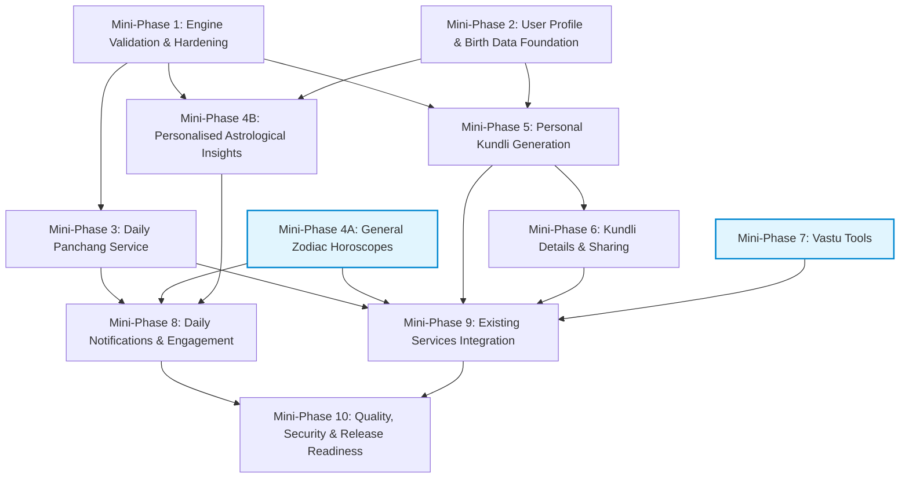

# Astro Setu — Master Product Roadmap & Architectural Evolution

**Project:** Astro Setu (Vedic Astrology, Spiritual Guidance & Consultation Platform)  
**Document:** Master Product Roadmap, Mini-Phase Specifications & Implementation Strategy  
**Destination:** `C:\wamp64\www\astro_setu\docs\ASTRO_SETU_PRODUCT_ROADMAP.md`  
**Owner:** Astro Setu Product & Engineering Team  
**Date:** November 2026 (Revision 1.4)  
**Status:** Draft for Review / Pending Product Approval  

---

## 1. Document Purpose, Decision Categories & Governance

### 1.1 Purpose
This document serves as the authoritative blueprint for the product redesign, computational engine integration, and feature expansion of **Astro Setu**. It bridges product strategy, astronomical engineering standards, mobile user experience, and backend systems architecture.

The roadmap defines:
- The transition from an astrologer directory and spiritual e-commerce app into a high-retention daily astrological companion.
- A 10-part phased breakdown of **Product Phase 1: Daily Value, Astrology and User Engagement**.
- The strategic outline of **Product Phase 2: Future Expansion**.
- Clear technical boundaries, prerequisites, acceptance criteria, and dependency chains.
- An auditable, progressive tracking mechanism to monitor implementation health without ambiguity.

### 1.2 Explicit Decision & Status Taxonomy
To eliminate ambiguity between established project foundations, technical proposals, and unverified assumptions, all items throughout this document are classified under the following strict taxonomy:

- `CONFIRMED`: An explicitly agreed product requirement, an established project constraint, or a verified existing architectural fact.
- `PROPOSED`: A suggested feature, technical implementation, UX pattern, or acceptance criterion under evaluation awaiting formal product approval. *(Note: All provisional targets, such as execution benchmarks or candidate numerical tolerances, are classified under `PROPOSED`, with their provisional status detailed in the accompanying explanatory text pending empirical validation).*
- `TBD — DECISION REQUIRED`: A choice that requires further research, technical validation, or product-owner approval.
- `IMPLEMENTED`: Functionality verified in the actual codebase.
- `IN PROGRESS`: Work currently being implemented or validated.
- `NOT STARTED`: Work scheduled for future mini-phases that has not yet begun.

### 1.3 Core Confirmed Architectural & Strategic Commitments
The following foundational commitments have been explicitly confirmed and govern all planning:
1. `CONFIRMED`: **Two-Phase Strategy:** The product evolution is strictly divided into Phase 1 (Daily Value, Astrology & User Engagement) and Phase 2 (Future Expansion & Commercial Scaling).
2. `CONFIRMED`: **Ten Mini-Phases:** Phase 1 comprises ten structured mini-phases executing in logical sequence.
3. `CONFIRMED`: **Free Daily-Value Core:** Daily utility (Panchang, Kundli, Horoscopes, Vastu) is offered freely to build engagement and trust, anchoring the platform.
4. `CONFIRMED`: **Preservation of Existing Revenue Services:** Existing astrologer live chat, Pooja booking catalog, user virtual wallet, and Razorpay checkout functionality are preserved without regression.
5. `CONFIRMED`: **Donations Hidden in Phase 1:** Spiritual donations must remain hidden from users during Product Phase 1 until formal operationalization in Phase 2.
6. `CONFIRMED`: **User Birth Data Privacy:** User birth information and Kundli charts must **never** be shared with an astrologer without explicit user consent.
7. `CONFIRMED`: **Panchang Independent of Profiles:** Viewing daily Panchang must **not** require user registration or a saved birth profile; it operates with default or user-selected locations.
8. `CONFIRMED`: **Vastu Independent of Astrology Engine:** Vastu compass tools operate independently of the astrology calculation engine, user birth profiles, and Panchang calculations.
9. `CONFIRMED`: **No Premature Convention Lock-In:** Default astronomical calculation conventions (ayanamsha, house system, lunar nodes) are established only after independent validation and explicit sign-off.

### 1.4 Ownership
- **Product Owner:** Astro Setu Product Team
- **Calculation Engineering:** Astro Setu Calculation Engine Team
- **Backend Systems:** Astro Setu Backend Engineering Team
- **Mobile Experience:** Astro Setu Mobile Engineering Team
- **Review Cadence:** Evaluated and updated at the inception and completion of every mini-phase.

---

## 2. Product Vision

### 2.1 The Core Mission
Astro Setu's mission is to become the most trustworthy, accurate, and culturally authentic digital Vedic astrology and spiritual services platform for millions of users worldwide. 

Rather than treating astrology purely as a transactional gateway to paid consultations, Astro Setu anchors the user experience in **daily spiritual utility and computational precision**. By delivering daily Panchang, accurate birth charts (Kundli), timely planetary insights, and spiritual tools for free, Astro Setu builds continuous daily engagement, trust, and brand loyalty.

### 2.2 Two-Phased Strategic Trajectory

```
+-----------------------------------------------------------------------------------------------+
|                                      PRODUCT VISION                                           |
+-----------------------------------------------------------------------------------------------+
|                                                                                               |
|  [PHASE 1: Daily Value, Astrology & User Engagement] (Current Focus)                          |
|  - In-House Native Astronomical Ephemeris (glibc 2.28 Standalone Moshier Engine)             |
|  - Daily Panchang Service (Tithi, Nakshatra, Yoga, Karana, Vara, Shubh/Ashubh Timings)        |
|  - High-Precision Kundli Generation (North Indian Chart, Verified Ascendant & Planets)        |
|  - Daily Horoscopes (Clean separation between general sign content and personal insights)    |
|  - Vastu Tools (Physical compass measurements with traditional directional guidance)          |
|  - Preserved Marketplace (Astrologer 1-on-1 Chat, Pooja Booking, Wallet Transactions)         |
|  - Donations HELD HIDDEN during Phase 1 until formal operationalization                       |
|                                                                                               |
|                                            │                                                  |
|                                            ▼                                                  |
|  [PHASE 2: Future Expansion & Commercial Scaling] (Future Long-Term)                         |
|  - Advanced Computational Astrology (Choghadiya, Divisional Charts D9/D10, Ashtakavarga)      |
|  - Paid Comprehensive Downloadable Astrology & Life Reports                                   |
|  - Religious Products & Spiritual E-Commerce Store                                            |
|  - Expanded Audio/Video Scheduled Consultations                                              |
|  - Expanded Pooja Services with Enhanced Ritual Engagement                                    |
|  - Re-Introduction of Verified Charitable Donations (Hidden in Phase 1)                       |
|  - Spiritual Learning & Dharmic Knowledge Hub                                                 |
+-----------------------------------------------------------------------------------------------+
```

---

## 3. Existing Platform Overview

Based on the architectural audit documented in `docs/ASTRO_SETU_EXISTING_APP_AUDIT.md`, the baseline application consists of:

### 3.1 Technology Stack Baseline (`IMPLEMENTED`)
- **Mobile Application:** Flutter 3.x (Dart `^3.5.4`), GetX (`^4.7.2`) reactive state management, `http` REST networking, `shared_preferences` storage, localized in English (`en`) and Hindi (`hi`).
- **Backend API & Admin:** Laravel (PHP 8.2+ / 8.4 CLI), MySQL database, web-based admin control panel for content management, Blade view rendering, and JSON REST APIs.
- **Consultation Infrastructure:** Real-time 1-on-1 chat consultation powered by Firebase Cloud Firestore, integrated with a per-minute wallet debiting mechanism.
- **Push Notifications:** Firebase Cloud Messaging (FCM v1) for chat alerts and broadcast horoscope notifications.
- **Payments:** Razorpay gateway integration for Indian Rupee (INR) wallet recharges, Pooja bookings, and donations.

### 3.2 Existing Active Services (`IMPLEMENTED` — Preserved Without Regression)
1. **Astrologer Directory & Profile Discovery:** Users browse verified astrologers by expertise (Vedic, Tarot, Numerology) and languages.
2. **Real-Time Paid Chat Consultations:** Pay-per-minute live chat with automated wallet deduction, low-balance warnings, and auto-termination.
3. **Pooja Discovery & Booking:** Catalog of temple rituals with date selection, attendee detail forms, and Razorpay checkout.
4. **Virtual User Wallet:** Digital ledger supporting recharges, transaction history, and per-minute consultation deductions.
5. **Static Horoscope Publishing:** Admin-curated daily/weekly/monthly horoscope text for 12 zodiac signs with ₹51 paywall for extended forecasts.

### 3.3 Key Architectural Discoveries to Address in Phase 1
- **Absence of Computational Astrology:** Currently, no automated planetary calculation, Kundli generation, or dynamic Panchang exists in production.
- **Registration Architecture:** The mobile app relies primarily on Google OAuth; the email registration screen (`sign_up.dart`) is currently an unlinked stub. (Decisions on registration expansion are categorized under Mini-Phase 2).
- **Free-Form Birth Data:** User profile stores birth place and birth time as unvalidated free-form strings without latitude/longitude coordinates or IANA timezone identifiers.
- **No Free Daily Utility:** Users currently have limited reasons to open the app daily unless seeking a paid consultation or reading static horoscope text.

---

## 4. Overall Product Roadmap & Dependency Architecture

### 4.1 Dependency Graph



### 4.2 Dependency Principles
1. `CONFIRMED`: **Mini-Phase 1 is the computational foundation:** Core ephemeris and astronomical calculations must be validated before any calculated astrological service can be released.
2. `CONFIRMED`: **Mini-Phase 2 is the personal birth foundation:** Required for personal birth charts (Kundli) and personal Moon-transit insights.
3. `CONFIRMED`: **Mini-Phase 3 (Daily Panchang) is location-based, NOT profile-dependent:** Any user (guest or authenticated) can view daily Panchang by selecting a location or using a default city (e.g., New Delhi). It does **not** depend on Mini-Phase 2.
4. `CONFIRMED`: **Mini-Phase 4 bifurcates cleanly:** General zodiac horoscopes can operate independently using the existing CMS; personal insights require validated transit calculations (M1) and user birth data (M2).
5. `CONFIRMED`: **Mini-Phase 5 (Kundli) requires both M1 and M2:** Cannot compute a birth chart without both an accurate engine and verified birth coordinates/time.
6. `CONFIRMED`: **Mini-Phase 6 (Kundli Details & Sharing) requires M5:** Extends the generated chart.
7. `CONFIRMED`: **Mini-Phase 7 (Vastu) is independent of astrology calculations:** Operates independently of the astrology calculation engine, user birth profiles, and Panchang calculations. Compass sensor measurements may be performed on-device, while magnetic declination correction may use location coordinates and geomagnetic reference data, and traditional architectural guidelines are provided via backend services.
8. `CONFIRMED`: **Mini-Phase 8 (Notifications) depends on delivered data:** Requires Panchang (M3) and Horoscope (M4) services to have content to dispatch.
9. `CONFIRMED`: **Mini-Phase 9 (Integration):** Combines new validated services into the existing app shell while hiding donations.
10. `CONFIRMED`: **Mini-Phase 10 (Release Readiness):** Final cross-cutting milestone across security, performance, and store compliance.

---

## 5. Product Phase 1 — Detailed Mini-Phase Breakdown

---

### Mini-Phase 1: Astrology Engine Validation and Hardening

- **Status:** `IN PROGRESS`
- **Objective:** `CONFIRMED`: Establish an independently validated, hardened, and mathematically verified astronomical calculation engine on both local environments and Hostinger shared hosting infrastructure.

#### Architectural Boundaries & Reference Distinction:
- **Runtime Native Engine (`CONFIRMED`):** Astro Setu executes calculations at runtime using the compiled in-house C/C++ Moshier astronomical ephemeris library (`jme.dll` on Windows x64, `libjme.so` glibc 2.28 on Linux x86_64), loaded via PHP FFI (`ext-ffi`).
- **Independent Validation References (`CONFIRMED`):** External astronomical systems (such as NASA JPL Horizons DE440/DE441 ephemerides, Indian Positional Astronomy Centre / IMD ephemeris tables, Drik Panchang, and Swiss Ephemeris) serve strictly as independent reference and verification baselines during testing.
- **Licensing & Runtime Clarification (`CONFIRMED`):** Utilizing Swiss Ephemeris as an external comparison baseline during scientific testing does **not** introduce it as a runtime software dependency, nor does Astro Setu adopt the Swiss Ephemeris runtime library or its dual-licensing (GPL/commercial) model.
- **Calculation Conventions (`CONFIRMED`):** Selection of production calculation conventions (Ayanamsha, house systems, lunar node models) is distinct from both the reference datasets and the underlying runtime library. Default conventions are established only after independent validation and explicit sign-off.

#### Scope & Requirements:
1. `CONFIRMED`: Native shared library compilation and loading verification (`jme.dll` on Windows x64, `libjme.so` glibc 2.28 on Linux x86_64).
2. `CONFIRMED`: Evaluation and documentation of supported ayanamsha conventions (True Citra, Traditional Lahiri Mode 1, Lahiri ICRC Mode 406, Krishnamurti, Raman) without premature selection.
3. `CONFIRMED`: Requirement for Independent Reference Comparison Recording: Every independent astronomical comparison must record:
   - Reference system and exact dataset/version (e.g., NASA JPL Horizons DE440, IPAC/IMD ephemeris tables).
   - Reference date/time and time scale (UT1 vs TT vs TDB vs UTC).
   - Observer coordinates and geocentric vs topocentric configuration.
   - Coordinate frame (dynamical ecliptic of date vs J2000) and tropical vs sidereal convention.
   - Ayanamsha formula and other relevant calculation conventions.
   - The comparison method and calculated angular or temporal difference.
4. `PROPOSED`: Mathematical evaluation and comparative documentation of house-system options (Equal Rashi Bhava, Placidus, Sripathi, Whole Sign).
5. `PROPOSED`: Calculation validation across all 9 Navagrahas (Sun, Moon, Mercury, Venus, Mars, Jupiter, Saturn, Rahu Mean/True, Ketu $180^\circ$ polar opposite).
6. `PROPOSED`: Topocentric sunrise and sunset calculations accounting for atmospheric refraction and solar disc semi-diameter.
7. `PROPOSED`: Core Panchanga limb bisections (Tithi, Nakshatra, Yoga, Karana) across daily boundaries.
8. `PROPOSED`: Vimshottari Dasha 120-year cycle mathematical formulation and boundary validation.
9. `PROPOSED`: Calculation audit records storing engine versions and exact convention parameters to ensure calculation reproducibility.
10. `PROPOSED`: Numerical accuracy tolerances: $\pm 0.05^\circ$ ($3$ arcmin) for planetary longitudes vs NASA JPL Horizons; $\pm 0.002^\circ$ ($7.2''$) for Ayanamsha; $\pm 60\text{ seconds}$ for sunrise/sunset and limb transitions. (Provisional targets pending formal comparison methodology and reference input approval).
11. `PROPOSED`: Performance targets: Execution benchmark of $< 750\text{ ms}$ for uncached core Panchang on Hostinger shared CPU, and $< 20\text{ ms}$ for cached requests. (Provisional targets pending repeatable multi-tenant benchmarks).

#### Out-of-Scope:
- Building user-facing mobile UI or Flutter screens.
- Modifying public API routes or database schemas.

#### Dependencies:
- Hostinger PHP CLI 8.4.27 with `ext-ffi` enabled in preload/CLI mode.
- Packaged glibc 2.28-compatible `libjme.so` in `packages/astrology/jpl-moshier-ephemeris-php/libs/jme-linux-x64-glibc228/`.

#### Deliverables:
- **Backend:** Automated regression suites in `tests/Unit/Astrology` and `tests/Feature/AstrologyEngineAccuracyTest.php`. Authoritative comparison protocol and documented conventions in `docs/ASTROLOGY_ENGINE_VALIDATION_PLAN.md`.
- **Flutter:** None (backend calculation engine only).
- **Admin:** CLI Artisan verification command (`php artisan astrology:poc`).

#### Verification & Acceptance Criteria:
1. Automated test suite executes cleanly on Hostinger production CLI using supported direct PHPUnit commands (`php vendor/bin/phpunit`) with zero errors, zero notices, and zero unhandled segfaults.
2. Independent astronomical accuracy validation completed across diverse geographic latitudes and historical epochs under the approved comparison methodology recorded in `docs/ASTROLOGY_ENGINE_VALIDATION_PLAN.md`.
3. Default calculation conventions formally reviewed and signed off.

> [!IMPORTANT]
> The passing of automated test runs on Hostinger indicates binary loading health and test-fixture alignment, but does **not** constitute proof of complete astronomical accuracy. Mini-Phase 1 remains `IN PROGRESS` until multi-latitude and multi-epoch validation against independent reference datasets is formally completed and signed off.

---

### Mini-Phase 2: User Astrology Profile and Data Foundation

- **Status:** `NOT STARTED`
- **Objective:** `CONFIRMED`: Establish an accurate, verified astrological birth data store that collects and canonicalizes geographic coordinates, IANA timezones, and birth data necessary for reproducible astronomical calculations.

#### Scope & Requirements:
1. `CONFIRMED`: **User Privacy, Consent and Data Control:** Users have full ownership over their stored birth data, including options to review, edit, and delete stored profiles. User birth information is strictly private and never shared without explicit consent.
2. `CONFIRMED`: **Birth-Time Precision Tier Differentiation:** The product architecture differentiates user birth data into three precision tiers: Complete Birth Profile, Approximate Birth Profile, and Partial Birth Profile.
3. `PROPOSED`: **Detailed Profile Tier Definitions & Calculation Policies:**
   - **Tier A — Complete Birth Profile (Verified Birth Time):** User provides verified birth date and birth time (hours, minutes). Unlocks exact Lagna (Ascendant), exact Bhava (house) cusps, high-precision Vimshottari Dasha timelines, and personalized Moon-transit house analysis.
   - **Tier B — Approximate Birth Profile (Approximate Time Window):** User provides an approximate time window (e.g., morning, afternoon, evening, $\pm 1\text{ to }2\text{ hours}$).
     - *Distinction of Actions:* The roadmap strictly distinguishes between: (1) *Saving an approximate birth profile*, (2) *Generating an exact-time Kundli*, and (3) *Generating a future-approved approximate or range-based chart*.
     - *No Automatic Exact Chart:* Saving an approximate profile does **not** automatically authorize or trigger generation of an exact Lagna or house chart, as an approximate time window does not produce a mathematically reliable single Lagna.
     - *Policy Decision:* The calculation and display behavior for approximate profiles remains `TBD — DECISION REQUIRED` (options under evaluation: displaying a calculation range across the window, rendering a representative chart with a prominent approximation warning banner, or withholding house cusps while calculating interval-stable planetary attributes).
   - **Tier C — Partial Birth Profile (Unknown Birth Time):** User provides birth date and location only (birth time completely unknown).
     - *Safeguards Against Assumed Precision:* An unknown birth time does **not** automatically make every Moon-related attribute reliable. Because the Moon moves $\approx 13.2^\circ$ per day and transitions Nakshatras approximately every 24 hours, a Moon sign or Nakshatra may change in the middle of the birth date.
     - *Calculation Safeguard Principles:*
       1. A single result (such as Moon sign or Nakshatra) may be displayed only when it remains mathematically valid throughout the entire relevant possible birth-time interval (e.g., across the entire 24-hour civil date at the birth location).
       2. If the attribute changes within that interval, the system must either communicate the possible range/options (e.g., "Moon in Mesha or Vrishabha") or withhold the result until an approved calculation and display policy exists.
       3. The system must **never** silently substitute an assumed birth time (such as 00:00, 06:00, or 12:00) and present the resulting calculation as exact or certain.
       4. Specific unknown-time chart conventions (such as Surya Kundli, local noon chart, or date-only interval presentation) remain `TBD — DECISION REQUIRED`.
4. `PROPOSED`: Storing structured user birth attributes: Date of Birth (`date`), Birth City (`string`), Country (`string`), Latitude (`decimal(10,7)`), Longitude (`decimal(10,7)`), and canonical IANA Timezone Identifier (`string`, e.g., `Asia/Kolkata`).
5. `PROPOSED`: City search and geocoding integration: Autocomplete mechanism providing verified coordinates and recognized IANA timezones.
6. `PROPOSED`: Coordinate input validation enforcing valid physical bounds ($-90^\circ$ to $+90^\circ$ latitude, $-180^\circ$ to $+180^\circ$ longitude).
7. `PROPOSED`: Support for multiple family/sub-profiles (e.g., Self, Spouse, Child, Parent) under a single user account.
8. `PROPOSED`: Profile-switching UI mechanism in Flutter GetX state management.
9. `PROPOSED`: Native email/password and phone OTP registration enhancements in Flutter (`sign_up.dart`).

#### TBD — Decisions Required:
- **TBD-2.1 (Multiple Profiles):** Should one user account support multiple birth profiles (family members), and if so, what is the maximum profile quota per user?
- **TBD-2.2 (Profile Sharing):** Can profiles be exported, shared, or transferred between registered users?
- **TBD-2.3 (Unknown Birth Time Convention):** What exact calculation convention should be selected when birth time is unknown (e.g., Sunrise chart / *Surya Kundli* vs. 12:00 PM local noon chart vs. date-only Moon chart without houses)?
- **TBD-2.4 (Approximate Time Handling UX):** When an approximate time window is supplied, should the UI display a range of possible Lagnas, render a representative chart with a warning banner, or suppress house cusps entirely?
- **TBD-2.5 (Geocoding Source):** Which geocoding provider should be selected (Google Places API vs. OpenStreetMap Nominatim vs. static offline Indian gazetteer database)?
- **TBD-2.6 (Registration Architecture):** Should the current Google OAuth-first registration be retained with optional email signup, or should a comprehensive phone OTP / email flow be prioritized?

#### Deliverables:
- **Backend:** Database migration for `users` / `user_astrology_profiles`. REST endpoints for profile CRUD and location lookup (`GET /api/v1/geo/cities`).
- **Flutter:** Updated `EditProfileScreen` with geocoded city autocomplete, birth time options (exact, approximate window, unknown), and profile view.
- **Admin:** User profile data inspection view with export/anonymization capabilities.

#### Acceptance Criteria:
1. User can enter birth date, birth time, and select a city from autocomplete, persisting validated geographic coordinates and a valid IANA timezone identifier.
2. Saving a partial birth profile (date and location only, birth time unknown) is supported; the profile cleanly indicates which time-dependent calculations are unavailable and strictly enforces safeguards against presenting ambiguous Moon attributes as exact.
3. Saving an approximate birth profile (with an approximate time window) is supported, but does **not** authorize or trigger generation of an exact Lagna or house chart.
4. Generating a complete birth chart with exact Lagna and house cusps is strictly restricted to complete birth profiles with verified birth times.
5. Generation of any approximate or range-based chart for approximate profiles is deferred until a formal calculation and display policy is approved (`TBD — DECISION REQUIRED`).
6. API validates coordinates within physical bounds and verifies recognized IANA timezone identifiers before persistence.

---

### Mini-Phase 3: Daily Panchang Service

- **Status:** `NOT STARTED`
- **Objective:** `CONFIRMED`: Provide users with an authentic, mathematically calculated daily Vedic Panchang for any selected date and geographic location, accessible freely without mandatory registration.

#### Scope & Requirements:
1. `CONFIRMED`: **No Mandatory Registration:** Viewing daily Panchang must work for guests and logged-in users alike, using a user-selected location or a default city (e.g., New Delhi). It does **not** require a saved user birth profile.
2. `PROPOSED`: Clean separation in the UI between mathematically calculated astronomical timings (sunrise, tithi moments, degrees) and traditional interpretive guidance (significance, deities, cultural recommendations).
3. `PROPOSED`: Core Panchanga Calculations:
   - **Tithi:** Active tithi at sunrise, active tithi at inquiry, start and end timestamps.
   - **Vara:** Solar weekday from local sunrise to sunrise (*Ravivara* through *Sanivara*).
   - **Nakshatra:** Lunar mansion (1 of 27), start and end timestamps.
   - **Yoga:** Soli-lunar combination (1 of 27), start and end timestamps.
   - **Karana:** Half-tithi (1 of 60), start and end timestamps.
4. `PROPOSED`: Solar and lunar timings: Topocentric Sunrise, Sunset, Moonrise, Moonset.
5. `PROPOSED`: Auspicious timings (*Shubh Muhurtas*): Abhijit Muhurta, Brahma Muhurta, Amrit Kaal.
6. `PROPOSED`: Inauspicious timings (*Ashubh Timings*): Rahu Kaalam, Yamaganda, Gulika Kaal, Durmuhurtham, Varjyam.
7. `PROPOSED`: Calendar attributes: Samvat (Vikram, Saka), Ayana, Ritu, Lunar Month (Amanta and Purnimanta standards), Paksha.
8. `PROPOSED`: Deterministic caching strategy using `CanonicalPanchangCacheKey`.
9. `PROPOSED`: Background precomputation via scheduled CLI jobs for selected high-density population centers.
10. `PROPOSED`: Performance target: Response time $< 750\text{ ms}$ uncached, $< 20\text{ ms}$ cached on Hostinger shared environment (provisional benchmark pending multi-tenant testing).

#### TBD — Decisions Required:
- **TBD-3.1 (Default Location):** What is the agreed fallback default location when a guest opens the app without location permissions (e.g., New Delhi: $28.6139^\circ\text{ N}, 77.2090^\circ\text{ E}$)?
- **TBD-3.2 (Precomputation Scope):** How many cities should be precomputed daily via cron (e.g., top 10 vs. top 50 cities), balancing hosting resource limits against cache hit rates?

#### Deliverables:
- **Backend:** `PanchangService` with `skip_festivals=true` for core daily speed. REST API: `GET /api/v1/panchang/daily?date=YYYY-MM-DD&lat={lat}&lon={lon}&tz={tz}`.
- **Flutter:** Dedicated `PanchangScreen` with date picker ribbon, city selector, Five Limbs cards, and auspicious/inauspicious visual strips.
- **Admin:** Cache performance monitor.

#### Acceptance Criteria:
1. Panchang displays core daily limbs and sunrise/sunset for any valid global location and date without requiring a user account or profile.
2. Tithi and Nakshatra transition timings match authoritative ephemeris within documented tolerances.
3. Cached lookups execute cleanly under the proposed performance target.

---

### Mini-Phase 4: Daily Horoscope and Personalised Insights

- **Status:** `NOT STARTED`
- **Objective:** `CONFIRMED`: Upgrade the existing horoscope system into an engaging, structured feature that cleanly separates general sign forecasts from mathematically calculated personal transits.

#### Scope & Requirements:
1. `CONFIRMED`: **Clean Bifurcation of Forecast Types:**
   - **A. General Zodiac Horoscopes (`CONFIRMED`):** Admin-curated daily guidance for all 12 signs across Love, Career, Health, and Finance. Operates independently of user profiles using existing CMS workflows.
   - **B. Personalised Astrological Insights (`PROPOSED`):** Transit insights derived from user's verified natal Moon sign (*Chandra Rashi*) and current transit planetary positions. Requires Mini-Phases 1 and 2.
2. `CONFIRMED`: **Ethical & Compliance Standards:** Health-related statements must be phrased responsibly as lifestyle/wellness mindfulness and must **never** be presented as medical diagnoses or medical advice.
3. `CONFIRMED`: **Multi-Lingual Support:** Editorial and calculated content must support English and Hindi parity.
4. `PROPOSED`: Traditional guidance elements (Lucky Color, Lucky Number, Favorable Time Window) mapped systematically to weekday rulers and transit nakshatras rather than arbitrary generation.
5. `PROPOSED`: Specific Moon-transit house placement rules (e.g., transit Moon 1st, 4th, 8th house screening / *Ashtama Shani* screening).
6. `PROPOSED`: Weekly and monthly extended forecast views.

#### TBD — Decisions Required:
- **TBD-4.1 (Personalized Transit Rules):** What exact Vedic transit methodology should govern personal insights (e.g., Gochara from natal Moon sign vs. Gochara from Lagna)?
- **TBD-4.2 (Lucky Elements Methodology):** Should Lucky Color and Lucky Number be generated from transit rulers, or should they be curated manually by astrologers in the CMS?
- **TBD-4.3 (Paywall Transition):** Should the existing ₹51 paywall on Tomorrow/Weekly/Monthly horoscopes be retained, modified, or replaced with free daily-engagement access?

#### Deliverables:
- **Backend:** CMS database tables for general horoscopes. REST API: `GET /api/v1/horoscope/daily?sign={sign}&date={date}`. REST API: `GET /api/v1/horoscope/personal` (authenticated).
- **Flutter:** Overhauled `HoroscopeScreen` with sign switcher, category tabs, and personal transit card (when complete profile exists).
- **Admin:** Publishing dashboard with bulk upload, drafting, scheduling, and preview capabilities.

#### Acceptance Criteria:
1. General horoscopes can be scheduled, published, and viewed for all 12 signs in English and Hindi without requiring user birth data.
2. Users with complete birth profiles see personalized transit insights clearly labeled as calculated personal data.
3. All health-related content displays clear non-medical wellness disclaimers.

---

### Mini-Phase 5: Personal Kundli Generation

- **Status:** `NOT STARTED`
- **Objective:** `CONFIRMED`: Compute and render high-precision Vedic birth charts (*Janam Kundli*), generating North Indian style diamond charts directly from verified birth data using the native calculation engine.

#### Scope & Requirements:
1. `CONFIRMED`: **Engine Independence & Precision Standards:** Calculation correctness is treated as an independent engineering requirement distinct from interpretive text quality.
2. `PROPOSED`: Accurate computation of **Lagna (Ascendant)** using verified date, time, and coordinates with topocentric oblique ascension.
3. `PROPOSED`: Planetary longitudes, zodiac signs (1–12), degrees, minutes, seconds, and Nakshatra Padas for Sun, Moon, Mercury, Venus, Mars, Jupiter, Saturn, Rahu (North Node), and Ketu ($180^\circ$ South Node).
4. `PROPOSED`: North Indian Diamond Chart presentation rendered natively in Flutter using vector graphics (`CustomPainter`).
5. `PROPOSED`: House assignments (1 to 12) displaying dynamic sign numbers and planetary symbols.
6. `PROPOSED`: Reproducible calculation records storing engine versions and convention parameters.
7. `PROPOSED`: True retrogression (*Vakri*) and combustion (*Asta*) detection based on relative solar angular separation.
8. `PROPOSED`: House cusp conventions (Equal Rashi Bhava vs. Sripathi / Placidus) evaluated pending Mini-Phase 1 validation sign-off.

#### TBD — Decisions Required:
- **TBD-5.1 (Ayanamsha Sign-Off):** Formal selection of default Ayanamsha (True Citra vs. Traditional Lahiri Mode 1 / 406) based on Mini-Phase 1 validation outcomes.
- **TBD-5.2 (House System Standard):** Selection of default house system for North Indian chart (Whole Sign / Equal Rashi Bhava vs. Sripathi / Porphyry vs. Placidus).
- **TBD-5.3 (Combustion Tolerances):** Specific angular degree thresholds for planetary combustion (*Asta*) for each classical planet.
- **TBD-5.4 (Node Calculation Convention):** Default selection of Mean Node vs. True Node for Rahu and Ketu.

#### Deliverables:
- **Backend:** `KundliService` implementing `KundliCalculatorInterface`. REST API: `POST /api/v1/kundli/generate`.
- **Flutter:** `KundliScreen` with interactive vector North Indian chart (`CustomPainter`), house tap highlights, and planetary tabular breakdown.
- **Admin:** Chart calculation reproduction and audit tool.

#### Acceptance Criteria:
1. User with a complete birth profile can generate and view their North Indian Kundli chart.
2. Lagna degree matches authoritative comparison reference (e.g. Swiss Ephemeris or JPL Horizons reference dataset) within approved tolerances under the documented comparison methodology. (Note: Swiss Ephemeris is used purely as an external comparison baseline for mathematical validation and is not a runtime software dependency).
3. Planetary longitudes match authoritative benchmarks within approved tolerances under the documented comparison methodology.
4. Chart vector renders crisply across various mobile resolutions without label clipping.

---

### Mini-Phase 6: Kundli Details and Sharing

- **Status:** `NOT STARTED`
- **Objective:** `CONFIRMED`: Expand the generated birth chart into an educational and shareable profile, introducing planetary house interpretations, Nakshatra analyses, Vimshottari Dasha timelines, and exportable reports.

#### Scope & Requirements:
1. `CONFIRMED`: **Ethical Guardrails & Disclaimers:** Prominent notifications stating that automated charts and interpretations are indicative and educational, not deterministic predictions or medical/legal advice.
2. `PROPOSED`: Foundational planetary and house placements: Planet in sign, planet in house, and basic astrological dignity (exalted, debilitated, own sign).
3. `PROPOSED`: Janma Nakshatra details: Nakshatra lord, deity, and foundational characteristics.
4. `PROPOSED`: Vimshottari Dasha timeline: Calculation of the 120-year cycle based on exact natal Moon longitude, displaying current active Mahadasha and Antardasha with start and end dates.
5. `PROPOSED`: Saving charts to local storage and user account.
6. `PROPOSED`: Single-page summary card generation formatted for WhatsApp and social sharing.
7. `PROPOSED`: Downloadable multi-page PDF Kundli report.
8. `PROPOSED`: Advanced interpretation text templates curated in admin CMS.

#### TBD — Decisions Required:
- **TBD-6.1 (Interpretation Depth):** What depth of classical interpretation text should be included in the free tier vs. reserved for paid consultations or Phase 2 reports?
- **TBD-6.2 (Dasha Sub-Levels):** Should Dasha display stop at Antardasha (level 2) or extend to Pratyantardasha (level 3)?
- **TBD-6.3 (PDF Layout & Branding):** Template design and branding specifications for downloadable Kundli reports.

#### Deliverables:
- **Backend:** `DashaService` computing Vimshottari transitions. Interpretation content repository. REST API: `GET /api/v1/kundli/{id}/dashas`. PDF generation endpoint.
- **Flutter:** Tabbed Kundli Detail View [Chart, Planets, Houses, Dasha, Report]. Native sharing sheet integration.
- **Admin:** Interpretation text editor in Laravel admin panel.

#### Acceptance Criteria:
1. Vimshottari Dasha transition dates match authoritative benchmarks within documented tolerances across 120 years.
2. User can save, revisit, and export a branded summary of their Kundli.
3. Every interpretation screen displays visible non-deterministic educational disclaimers.

---

### Mini-Phase 7: Vastu Tools

- **Status:** `NOT STARTED`
- **Objective:** `CONFIRMED`: Introduce an intuitive digital Vastu Compass tool in the mobile application to help users evaluate directional alignments according to traditional Vastu Shastra principles.

#### Scope & Requirements:
1. `CONFIRMED`: **Architectural Independence:** Mini-Phase 7 operates independently of the astrology calculation engine, user birth profiles, and Panchang calculations.
2. `PROPOSED`: **Multi-Layer Compass Architecture:** Architectural separation between:
   - **Sensor Measurement Layer:** Reading hardware magnetometer and accelerometer sensors on the mobile client.
   - **Magnetic North:** Sensed physical direction of Earth's local magnetic field lines.
   - **True North:** Geographic meridian toward the geographic North Pole.
   - **Magnetic Declination Correction:** Angle between Magnetic North and True North at the user's geographic coordinates.
   - **Geomagnetic Reference Data:** Model or lookup service providing local declination.
   - **Traditional Vastu Guidance:** Cultural and architectural guidelines mapped to directional sectors, delivered via backend APIs.
3. `PROPOSED`: Display of 8 primary and secondary directions (North, North-East / *Ishanya*, East, South-East / *Agneya*, South, South-West / *Nairrutya*, West, North-West / *Vayavya*).
4. `PROPOSED`: Sensor accuracy and calibration guidance: In-app prompt advising users to calibrate when sensor distortion or uncalibrated states are detected.
5. `PROPOSED`: 16-direction Vastu Chakra display with elemental color coding.
6. `PROPOSED`: Room-by-room guidance bottom sheet (Entrance, Kitchen, Bedroom, Pooja Room).
7. `PROPOSED`: Fallback manual direction selector for devices lacking hardware magnetometers.

#### TBD — Decisions Required:
- **TBD-7.1 (Geomagnetic Data Source):** Should magnetic declination be computed via an embedded lightweight World Magnetic Model (WMM) algorithm or obtained via an online API lookup?
- **TBD-7.2 (Sensor Fallback UX):** Confirm the exact fallback UI and experience when a device lacks a hardware compass sensor (e.g., manual interactive room wheel).
- **TBD-7.3 (Vastu Content Authority):** Which traditional Vastu textual tradition should govern room guidelines and elemental assignments?

#### Deliverables:
- **Backend:** REST API: `GET /api/v1/vastu/guidelines` providing categorized directional recommendations and remedies.
- **Flutter:** `VastuCompassScreen` with animated compass dial, calibration dialog, and room guidance sheet.
- **Admin:** Vastu content management interface in Laravel admin panel.

#### Acceptance Criteria:
1. Compass smoothly tracks device orientation and displays directional sectors with appropriate magnetic declination handling where supported.
2. Devices lacking magnetic sensors display a graceful fallback manual mode without crashing.
3. Physical measurements are clearly separated from interpretive traditional recommendations.

---

### Mini-Phase 8: Daily Notifications and Engagement

- **Status:** `NOT STARTED`
- **Objective:** `CONFIRMED`: Build an automated, localized notification engine that delivers timely astrological moments directly to users' devices, driving consistent daily engagement.

#### Scope & Requirements:
1. `CONFIRMED`: **User Consent & Notification Control:** Respecting user privacy with granular opt-in/opt-out controls for notifications.
2. `PROPOSED`: **Local-Time Delivery Architecture:** Ensuring notifications arrive according to the user's local civil/solar time rather than a fixed server timezone.
3. `PROPOSED`: **Notification Preferences Center:** Granular opt-in/opt-out toggles in the Flutter app for each notification stream, respecting user privacy and notification preferences.
4. `PROPOSED`: Quiet hours configuration preventing disturbance during late night / early morning.
5. `PROPOSED`: Deep-linking: Tapping a notification opens the exact corresponding screen within the Flutter app.
6. `PROPOSED`: Delivery resiliency: Idempotent queue workers preventing duplicate notifications.
7. `PROPOSED`: Core notification streams: Morning Panchang summary, daily horoscope alert, major festival/vrata reminders, Rahu Kaal alerts.
8. `PROPOSED`: Specific delivery schedules and advance lead times (marked as configurable product decisions).

#### TBD — Decisions Required:
- **TBD-8.1 (Notification Delivery Times):** Exact default delivery times for daily notifications (e.g., morning briefing window configurable by user vs. default morning time).
- **TBD-8.2 (Rahu Kaal Alert Lead Time):** Lead time for inauspicious timing warnings (e.g., advance alert before onset vs. morning summary only).
- **TBD-8.3 (Frequency Caps):** Maximum allowable automated notifications per user per 24-hour cycle to prevent notification fatigue.

#### Deliverables:
- **Backend:** Scheduled console commands (`php artisan notifications:dispatch`). Database tables `notification_logs` and `user_notification_preferences`.
- **Flutter:** `NotificationSettingsScreen` in Profile/Drawer. FCM payload handler with deep-linking router.
- **Admin:** Broadcast notification dashboard with language/sign filtering and delivery analytics.

#### Acceptance Criteria:
1. Notifications dispatch at the user's local time without duplicate sends.
2. Deep links route to the exact target screen across cold-start and background states.
3. Users can disable any specific notification stream from settings.

---

### Mini-Phase 9: Existing Services Integration

- **Status:** `NOT STARTED`
- **Objective:** `CONFIRMED`: Integrate new daily utility features with existing revenue-generating paid services (Astrologer Chat, Pooja Booking, Wallet), creating natural user journeys from free exploration to paid expert consultations without regressions.

#### Scope & Requirements:
1. `CONFIRMED`: **Preservation of Paid Services:** Zero regression in astrologer discovery, live Firestore chat, wallet per-minute debiting, Pooja discovery/booking, and Razorpay checkout.
2. `CONFIRMED`: **Donations Hidden in Phase 1:** Decouple and hide the central donation FAB and donation screens from primary Phase 1 navigation.
3. `CONFIRMED`: **Strict Privacy for Astrologer Data Sharing:** User birth data and Kundli must **never** be automatically exposed to astrologers without explicit user opt-in and consent during consultation initiation.
4. `PROPOSED`: Navigation structure update: Evaluating a refined 5-tab curved navigation bar (Home, Panchang, Kundli, Astrologers, Pooja) pending formal UX review.
5. `PROPOSED`: Contextual consultation pathways: Soft, optional suggestions linking free chart observations to paid consultations (e.g., "Discuss your chart with an astrologer").
6. `PROPOSED`: Home screen redesign balancing daily spiritual tools with featured astrologers and poojas.

#### TBD — Decisions Required:
- **TBD-9.1 (Navigation Shell Review):** Formal UX review and sign-off on the proposed navigation bar structure.
- **TBD-9.2 (Contextual Pathway Placements):** Specific UI guidelines on where and how paid consultation suggestions appear to ensure they remain helpful and non-intrusive.
- **TBD-9.3 (Astrologer Intake Consent Flow):** UX pattern for asking users: *"Share my birth chart with this astrologer for this session?"* before chat commences.

#### Deliverables:
- **Backend:** Endpoint for chat session initialization with optional consented birth chart summary.
- **Flutter:** Updated navigation shell, revamped `HomeScreen`, and consented chart-sharing intake sheet.
- **Admin:** Funnel conversion tracking from free tools to paid bookings.

#### Acceptance Criteria:
1. Donations are completely hidden from primary Phase 1 user flows.
2. 100% of existing wallet, chat, and pooja flows pass regression testing with zero defects.
3. User birth data is shared with astrologers only when the user explicitly grants permission.

---

### Mini-Phase 10: Quality, Security and Release Readiness

- **Status:** `NOT STARTED`
- **Objective:** `CONFIRMED`: Execute comprehensive end-to-end testing, harden security and data privacy, optimize shared-hosting performance, and complete pre-release requirements for production rollout.

#### Scope & Requirements:
1. `CONFIRMED`: **Data Protection & Authorization:** Strict policies ensuring users can only view or modify their own data.
2. `CONFIRMED`: **Secure Secret Management:** Payment keys, database credentials, and service tokens stored strictly in environment files outside version control.
3. `CONFIRMED`: **Hostinger Test Execution Compatibility:** Automated test execution on Hostinger must use direct PHPUnit commands (`php vendor/bin/phpunit`) rather than commands requiring process spawning (`proc_open`, `exec`), which are disabled on Hostinger shared hosting. Commands such as `php artisan test` cannot be used on Hostinger.
4. `PROPOSED`: End-to-end integration testing across all user journeys (registration $\rightarrow$ profile $\rightarrow$ panchang $\rightarrow$ kundli $\rightarrow$ chat $\rightarrow$ pooja $\rightarrow$ wallet).
5. `PROPOSED`: Shared-hosting queue and memory verification: Ensuring CLI cron workers operate within host limits without overlapping.
6. `PROPOSED`: Cross-platform Flutter verification across iOS and Android device profiles.
7. `PROPOSED`: Target release versioning and target memory thresholds (provisional criteria awaiting formal benchmarking).

#### TBD — Decisions Required:
- **TBD-10.1 (Release Versioning):** Formal release version numbering for the revamped application.
- **TBD-10.2 (Rollout Strategy):** Phased staged rollout percentage (e.g., 10% $\rightarrow$ 25% $\rightarrow$ 50% $\rightarrow$ 100% on Google Play).

#### Deliverables:
- **Backend:** Production deployment runbook for Hostinger. Health-check endpoint `GET /api/v1/health`. Database index optimizations.
- **Flutter:** Release builds (`.aab` / `.ipa`), offline error boundaries, and release notes in English and Hindi.
- **Admin:** Real-time queue and FFI health monitoring.

#### Acceptance Criteria:
1. Zero critical or high-severity vulnerabilities across backend and mobile apps.
2. Full automated test suite passes on Hostinger production environment via supported direct PHPUnit commands (`php vendor/bin/phpunit`).
3. Approved release candidate passes all store compliance guidelines.

---

## 6. Product Phase 2 — Future Expansion

Product Phase 2 represents the long-term commercial scaling, advanced computational astrology, and expanded spiritual offerings of Astro Setu. 

> [!IMPORTANT]
> All Phase 2 workstreams are strictly future roadmap items. No development, database migrations, or public exposure of these features will occur during Product Phase 1. Specifically, **Donations must remain hidden** from general users during Phase 1.

### Planned Phase 2 Workstreams (`PROPOSED` — High-Level Objectives):

1. **Donations and Religious Contributions (Re-Introduction):**
   - *Objective:* Re-introduce charitable giving once verified temple partnerships, transparent receipting, and legal/regulatory frameworks are formally established.
   - *Phase 1 Guardrail:* Hidden from primary navigation throughout Phase 1.

2. **Religious Products & Spiritual E-Commerce Store:**
   - *Objective:* Introduce an authentic store for certified gemstones, Rudraksha, Yantras, and pooja items, with inventory management and order tracking.

3. **Advanced Computational Astrology:**
   - *Objective:* Expand the in-house native calculation engine to support advanced Vedic methodologies:
     - **Choghadiya Tables:** Daytime and nighttime Choghadiya intervals.
     - **Divisional Charts (Shodashvarga):** D9 Navamsha, D10 Dashamsha, D7 Saptamsha, etc.
     - **Ashtakavarga & Shadbala:** Planetary strength and transit point evaluations.
     - **Kundli Matching (Gun Milan):** 36-point Ashtakoota compatibility analysis.

4. **Paid Comprehensive Astrology Reports:**
   - *Objective:* Generate comprehensive, in-depth downloadable life and annual transit reports available as paid digital purchases.

5. **Expanded Pooja Services:**
   - *Objective:* Enhance temple ritual bookings with live video streaming capabilities and personalized ritual updates.

6. **Spiritual Learning & Dharmic Content Hub:**
   - *Objective:* Create an educational repository of Vedic wisdom, mantras with audio pronunciation, stotrams, and planetary remedy guides.

7. **Expanded Audio & Video Consultations:**
   - *Objective:* Upgrade astrologer marketplace to include scheduled 1-on-1 audio and video calls via modern WebRTC infrastructure.

---

## 7. Dependencies & Recommended Implementation Sequence

### 7.1 Sequencing Rationale
1. **Engine Validation (M1):** Must proceed first to establish calculation accuracy before user-facing astrology features are exposed.
2. **Parallel Streams:**
   - **Panchang (M3):** Can proceed as soon as M1 core calculations are validated, operating with default or user-selected locations without waiting for birth profiles.
   - **User Profile (M2):** Can proceed in parallel with M3 to prepare the data foundation for personal birth charts.
   - **Vastu (M7):** Independent workstream that can proceed at any time.
3. **Kundli Pipeline (M5 $\rightarrow$ M6):** Commences once both Engine (M1) and Profile (M2) foundations are stable.
4. **Horoscope Bifurcation (M4):** General horoscopes can be published immediately; personalized insights activate once M1 and M2 are operational.
5. **Engagement Layer (M8):** Connects M3 and M4 to user retention via localized notifications.
6. **Integration & Release (M9 $\rightarrow$ M10):** Consolidates all capabilities, hides donations, and executes final security, performance, and store release readiness.

---

## 8. Current Project Status

### 8.1 Status Tracking Baseline

| # | Mini-Phase | Status | Start Date | Target Completion | Dependencies | Current Progress & Implementation State |
|---|------------|--------|------------|-------------------|--------------|-----------------------------------------|
| **1** | **Astrology Engine Validation** | **IN PROGRESS** | Oct 2026 | TBD — Decision Required | None | Native glibc 2.28 binary loads and executes; three reported PHPUnit runs comprising 29 test executions and 116 assertions in total passed on Hostinger CLI. Calculations initially aligned with selected historical test fixtures. Independent multi-latitude astronomical validation against authoritative references, formal reference comparison methodology, and multi-tenant performance benchmarking remain in progress. |
| **2** | **User Astrology Profile** | **NOT STARTED** | TBD | TBD | M1 conventions | Free-form profile fields exist in baseline app. Database schema expansion, coordinate canonicalization, and geocoding integration not yet started. |
| **3** | **Daily Panchang Service** | **NOT STARTED** | TBD | TBD | M1 | Independent of profile; supports default/selected city. Core ephemeris limb bisection executable in engine; Panchang API & Flutter UI not yet started. |
| **4** | **Daily Horoscope & Insights** | **NOT STARTED** | TBD | TBD | M1, M2 (Personal) | Static 12-sign horoscopes exist in baseline app. Automated personal Moon-transit insights and updated CMS workflows not yet started. |
| **5** | **Kundli Generation** | **NOT STARTED** | TBD | TBD | M1, M2 | Native planetary longitudes and houses executable in engine. Kundli API, data persistence, and Flutter CustomPainter not yet started. |
| **6** | **Kundli Details & Sharing** | **NOT STARTED** | TBD | TBD | M5 | Dasha calculations and report export not yet started. |
| **7** | **Vastu Tools** | **NOT STARTED** | TBD | TBD | None | Independent workstream. Compass sensor integration and guidelines API not yet started. |
| **8** | **Notifications & Engagement** | **NOT STARTED** | TBD | TBD | M3, M4 | FCM v1 active for chat alerts in baseline app. Timezone-aware daily automated notification scheduler not yet started. |
| **9** | **Existing Services Integration**| **NOT STARTED**| TBD | TBD | M3, M4, M5, M6, M7 | Existing chat, pooja, and wallet active. Navigation shell update and donation hiding not yet started. |
| **10**| **Quality & Release Readiness** | **NOT STARTED** | TBD | TBD | M8, M9 | Full regression, security hardening, and release preparation not yet started. |

### 8.2 Reported Hostinger Test Execution Record

The native calculation engine has been executed directly on the live Hostinger CLI environment (PHP CLI 8.4.27, Linux x86_64, glibc 2.28) using direct PHPUnit commands with the following reported execution results:

```
1. Native Ephemeris Resolver Suite:
   Command: php vendor/bin/phpunit --filter NativeEphemerisResolverTest
   Result:  6 tests passed, 12 assertions (0 skips, 0 notices)

2. Astrology Engine Accuracy & Astronomical Regression Suite:
   Command: php vendor/bin/phpunit --filter AstrologyEngineAccuracyTest
   Result:  10 tests passed, 69 assertions (0 skips, 0 notices)

3. Core Astrology Unit Suite:
   Command: php vendor/bin/phpunit tests/Unit/Astrology
   Result:  13 tests passed, 35 assertions (0 skips, 0 notices)

SUMMARY OF REPORTED RUNS:
Three reported PHPUnit runs comprising 29 test executions and 116 assertions in total.
```

> [!IMPORTANT]
> **Distinction Between Test Execution and Independent Astronomical Truth:**  
> The successful execution of these three reported PHPUnit runs comprising 29 test executions and 116 assertions in total demonstrates that the standalone Moshier library loads and executes reliably on Hostinger glibc 2.28 without PHP FFI errors, and that its calculations align with the specific historical fixtures hardcoded in those tests.  
> However, this does **not** constitute complete independent astronomical validation or production readiness. Mini-Phase 1 remains `IN PROGRESS` until a formal reference comparison methodology is established, multi-latitude test suites are executed, and default conventions are signed off.

---

## 9. Definition of Done & Acceptance Criteria

A mini-phase is only marked as **Completed** when it meets all of the following criteria:

### 9.1 Architectural & Code Quality
- [ ] No regression in existing paid services (Chat, Pooja, Wallet, Payments).
- [ ] Code adheres to PSR-12 (Laravel) and Effective Dart guidelines.
- [ ] No hardcoded secrets, database credentials, or API keys in repository files.
- [ ] All database schema modifications are managed via reproducible Laravel migrations.

### 9.2 Verification & Test Coverage
- [ ] 100% of new unit and integration tests pass without skips or notices.
- [ ] Verified execution on both local development environments and the Hostinger production CLI using supported commands (`php vendor/bin/phpunit`).
- [ ] Astronomical calculations validated within documented scientific tolerances against independent ground truth under the approved comparison methodology.

### 9.3 User Experience & Cross-Platform Stability
- [ ] Flutter UI renders cleanly across varying screen sizes without layout overflow errors.
- [ ] Localization parity: All new user-facing strings are available in both English and Hindi.
- [ ] Error boundary handling: Network failures, timeouts, and missing hardware sensors display graceful, actionable user feedback.

### 9.4 Documentation & Maintainability
- [ ] API endpoints documented with request/response schemas.
- [ ] Roadmap progress table updated with actual completion date and verification evidence.

---

## 10. Risks and Technical Dependencies

### 10.1 Hostinger Shared Hosting Environment Constraints
- **Risk:** PHP FFI is restricted to CLI mode (`ffi.enable=preload`); direct FFI calls in synchronous web PHP requests are blocked. Furthermore, process-spawning functions (`proc_open`, `exec`, `shell_exec`, `system`) are disabled by Hostinger security policies. As a consequence, commands like `php artisan test` (which internally invoke `proc_open`) cannot execute on Hostinger.
- **Mitigation:** Web HTTP endpoints must never attempt direct FFI execution; calculations rely on precalculated cache keys or background queue workers run periodically via CLI cron jobs (`php artisan queue:work --stop-when-empty`). All automated testing on Hostinger must use direct PHPUnit commands (`php vendor/bin/phpunit`).

### 10.2 Hardware Sensor Variance in Mobile Devices
- **Risk:** In Mini-Phase 7 (Vastu Tools), budget Android smartphones often lack hardware magnetometers or experience magnetic distortion.
- **Mitigation:** The Flutter app must probe sensor capabilities upon opening the screen. If magnetometers are unavailable, the UI must automatically switch to a manual directional mode rather than failing or crashing.

### 10.3 Historical Timezone and Daylight Saving Discrepancies
- **Risk:** In Mini-Phase 2 and 5, birth times entered for users born prior to 1947 or in territories with historical Daylight Saving Time (DST) shifts can introduce up to $1^\circ$ error in the Lagna if standard civil offsets are naively assumed.
- **Mitigation:** Enforce canonical IANA timezone strings (e.g., `Asia/Kolkata`, `America/New_York`) rather than fixed numeric offsets (`+05:30`), allowing PHP's `DateTimeZone` database to apply historical timezone transitions.

### 10.4 Mobile Memory Footprint during Chart Rendering
- **Risk:** Repeated rendering of vector Kundli charts, canvas animations, and sensor loops can trigger memory leaks or frame drops on entry-level mobile devices.
- **Mitigation:** Enforce strict disposal of animation controllers, sensor stream subscriptions, and optimize `CustomPainter` repaint boundaries in Flutter.

---

## 11. Change Log

| Version | Date | Author / Owner | Description of Changes |
| :--- | :--- | :--- | :--- |
| **1.0** | November 1, 2026 | Astro Setu Team | Initial formal release of the Master Product Roadmap. Defined two-phase product vision, 10-part breakdown of Product Phase 1, Phase 2 future workstreams, dependency graph, initial baseline status, and verified Hostinger test execution metrics. |
| **1.1** | November 1, 2026 | Astro Setu Product & Engineering Team | Refinement of decision categories, dependency corrections, removal of unapproved Phase 2 commitments, and removal of external AI attribution. |
| **1.2** | November 1, 2026 | Astro Setu Product & Engineering Team | Refinement of decision categories, birth-time precision differentiation, Vastu sensor/declination boundaries, comparison methodology prerequisites, and Hostinger test command documentation. |
| **1.3** | November 1, 2026 | Astro Setu Product & Engineering Team | Targeted final corrections: strict re-audit of CONFIRMED labels, birth profile tier breakdown, Vastu calculation independence refinement, validation reference distinction, exact test phrasing, and Hostinger execution constraints. |
| **1.4** | November 1, 2026 | Astro Setu Product & Engineering Team | **Final Consistency Corrections Revision 1.4:**<br>1. **Corrected Remaining CONFIRMED Classifications:** Re-audited M1, M2, M3, M7, and M8. Reclassified unapproved implementation details (Panchang UI separation, multi-layer compass architecture, local-time delivery architecture, and notification preference center) as `PROPOSED`. Retained `CONFIRMED` strictly for verified facts, constraints, and approved core requirements.<br>2. **Reconciled Classification Taxonomy:** Eliminated standalone `PROVISIONAL` and `PROVISIONAL TARGET` tags. Consistently applied the six defined taxonomy categories (`CONFIRMED`, `PROPOSED`, `TBD — DECISION REQUIRED`, `IMPLEMENTED`, `IN PROGRESS`, `NOT STARTED`), detailing provisional benchmark targets in explanatory text under `PROPOSED`.<br>3. **Strengthened Partial Birth-Profile Safeguards (M2):** Mandated that an unknown birth time does not make Moon attributes certain. Enacted safeguards: single results displayed only if valid across the entire interval; range communicated or result withheld if attribute changes; prohibition of silent time substitutions. Kept unknown-time conventions as `TBD — DECISION REQUIRED`.<br>4. **Clarified Approximate Birth-Profile Acceptance Criteria (M2):** Explicitly distinguished saving an approximate profile from generating an exact-time Kundli or future approximate chart. Clarified that saving an approximate profile does not authorize exact chart generation; kept approximate-chart behavior as `TBD — DECISION REQUIRED`.<br>5. **Strengthened M1 Reference-Validation Requirements:** Formalized mandatory comparison records (system/dataset/version, timestamp/timescale, observer coordinates/geocentric-topocentric, coordinate frame/tropical-sidereal, ayanamsha, comparison method/difference). Kept numerical tolerances provisional until methodology approval without changing native Moshier runtime architecture.<br>6. **Preserved Boundaries:** Maintained 2-phase strategy, 10 mini-phases, dependency graph, hidden donations, consent-based birth data sharing, and accurate test results wording. |
