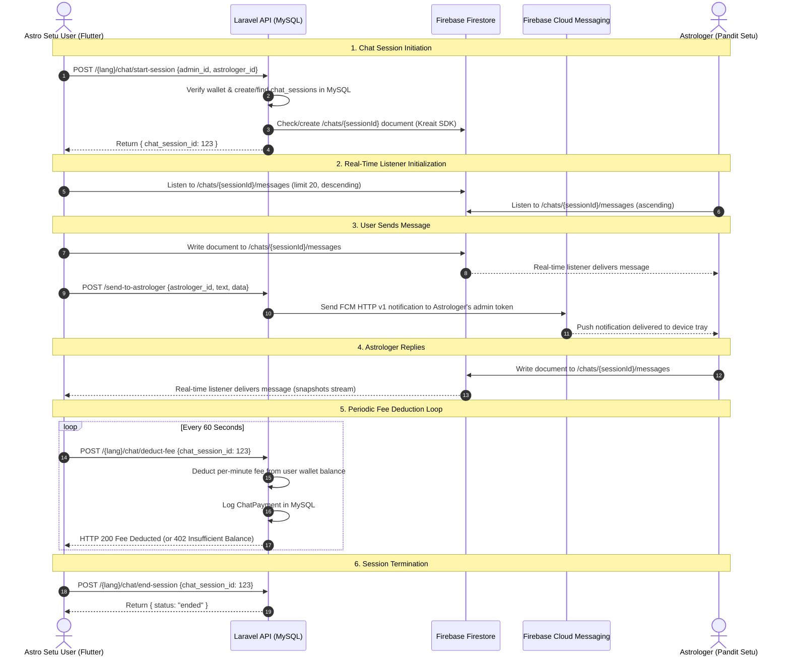

# Phase 1 Audit: Current Chat Architecture & Implementation Analysis

**Audit Date:** November 2026  
**Projects Analyzed:**
- **Astro Setu (Flutter Mobile App):** `C:\Users\rsrav\StudioProjects\astro_setu`
- **Pandit Setu (Astrologer App - Reference Only):** `C:\Users\rsrav\StudioProjects\astrologer_chat_app`
- **Astro Setu Backend (Laravel 11 / PHP 8.4):** `C:\wamp64\www\astro_setu`

---

## Executive Summary of Current Reality

The existing chat implementation between Astro Setu and Pandit Setu is an **asymmetric hybrid system** where:
1. **Chat Session Lifecycle & Billing** are managed via Laravel API endpoints (`chat/start-session`, `chat/deduct-fee`, `chat/end-session`) backed by MySQL.
2. **Real-time Message Transport and Message Storage** are performed **almost entirely on Firebase Firestore**, bypassing Laravel MySQL for live chat messages.
3. When an Astro Setu user sends a message, Flutter writes directly to Firestore (`chats/{sessionId}/messages`) and then makes an HTTP call to Laravel (`send-to-astrologer`) to trigger a Firebase Cloud Messaging (FCM) push notification to the astrologer.
4. **Chat messages are NOT saved in MySQL** during active user chats. Although a MySQL `chats` table and a `FirebaseChatController::store` controller method exist, this endpoint is **never called** by Astro Setu.
5. **Chat History** is loaded directly from Firestore query snapshots (`orderBy('timestamp', descending: true).limit(20)`); no Laravel MySQL history endpoint is consumed by the user client.
6. **Authentication is NOT Firebase Auth** for users. Astro Setu uses standard Google Sign-In (`google_sign_in`) and Laravel Sanctum tokens. Firestore security rules currently allow unauthenticated message writes (`request.auth == null`) or rely on permissive rules.

---

## 1. Flutter Application Audit (Astro Setu)

### 1.1 Firebase Initialization
- **Location:** [`lib/main.dart`](file:///C:/Users/rsrav/StudioProjects/astro_setu/lib/main.dart#L28-L38)
- **Implementation:**
  ```dart
  WidgetsFlutterBinding.ensureInitialized();
  await Firebase.initializeApp(
    options: DefaultFirebaseOptions.currentPlatform,
  );
  ```
- **Configuration File:** [`lib/firebase_options.dart`](file:///C:/Users/rsrav/StudioProjects/astro_setu/lib/firebase_options.dart#L43-L61)
  - Project ID: `navgarah-bba2c`
  - Android App ID: `1:930342146166:android:bc3bb1dba4e1e445098f57`
  - iOS App ID: `1:930342146166:ios:dfc2999c119778c7098f57`
  - Storage Bucket: `navgarah-bba2c.firebasestorage.app`

### 1.2 Authentication Architecture
- **Dependency Declared:** `firebase_auth: ^5.5.4` in `pubspec.yaml`.
- **Actual Code Usage:** **ZERO usages of `FirebaseAuth` across the entire codebase.**
- **Actual User Authentication Flow:**
  - **Google Sign-In:** [`lib/controllers/auth_controller.dart`](file:///C:/Users/rsrav/StudioProjects/astro_setu/lib/controllers/auth_controller.dart#L329-L380) uses `package:google_sign_in` directly:
    ```dart
    final GoogleSignInAccount? googleUser = await googleSignIn.signIn();
    final GoogleSignInAuthentication googleAuth = await googleUser.authentication;
    final String? idToken = googleAuth.idToken;
    final response = await api.postData({"id_token": idToken}, "auth/google");
    ```
    The Google ID token is submitted to Laravel's `{lang?}/auth/google` endpoint. Laravel verifies it with `Google_Client` and issues a **Laravel Sanctum plaintext bearer token**.
  - **Email/Password:** Standard registration and login via Laravel API endpoints (`{lang?}/register` and `{lang?}/login`), returning Sanctum tokens.
  - **Token Storage:** Sanctum token is saved in `SharedPreferences` via `StorageService` (`StorageKeys.authToken`).
  - **Conclusion:** Astro Setu clients **never sign in to Firebase Auth**.

### 1.3 Firebase Cloud Messaging (FCM) Implementation
- **Service:** [`lib/services/firebase_messaging_service.dart`](file:///C:/Users/rsrav/StudioProjects/astro_setu/lib/services/firebase_messaging_service.dart#L19-L270)
- **Initialization:** Invoked in `main.dart` via `FirebaseMessagingService.instance().init(...)`.
- **Lifecycle Handlers:**
  - Foreground messages: `FirebaseMessaging.onMessage.listen(_onForegroundMessage)` -> dispatches to `LocalNotificationsService.instance().showNotification()`.
  - Background messages: `FirebaseMessaging.onBackgroundMessage(_firebaseMessagingBackgroundHandler)` (top-level VM entry point).
  - Background-to-foreground tap: `FirebaseMessaging.onMessageOpenedApp.listen(_onMessageOpenedApp)`.
  - Cold-start tap: `FirebaseMessaging.instance.getInitialMessage()`.
- **Device Token Registration:**
  - Methods: `_handlePushNotificationsToken()`, `syncDeviceRegistration()`, and `onTokenRefresh`.
  - Registers FCM token with backend via `POST v1/notifications/devices/register` with payload containing `fcm_token`, `device_id`, `platform`, `device_model`, and `timezone`.
- **Topic Subscriptions:** Broadcast topics (`horoscope-$lang`, `pooja-$lang`, `donation-$lang`, `astrologers-$lang`).
- **Notification Navigation Defect Found:**
  - In `handleNotificationRouting(Map<String, dynamic> data)`:
    ```dart
    final rawType = (data['screen'] ?? data['type'])?.toString().toLowerCase().trim();
    if (rawType == 'panchang' || rawType == 'daily_panchang') { ... }
    else if (rawType == 'horoscope' || rawType == 'daily_horoscope') { ... }
    else if (rawType == 'personalized_insights' || ...) { ... }
    ```
  - **CRITICAL DEFECT:** There is **no handling for `chat_message` or chat screen routing**. When a user taps a chat notification, the app opens to the home screen without navigating to the relevant chat.

### 1.4 Cloud Firestore Configuration & Document Structure
- **Firestore Instance:** `FirebaseFirestore.instance` accessed directly in:
  - [`lib/controllers/chat_controller.dart`](file:///C:/Users/rsrav/StudioProjects/astro_setu/lib/controllers/chat_controller.dart#L58-L72)
  - [`lib/services/chat_firebase_service.dart`](file:///C:/Users/rsrav/StudioProjects/astro_setu/lib/services/chat_firebase_service.dart#L6-L50)
- **Firestore Collections & Schema:**
  1. **Session Document:** `/chats/{chatSessionId}`
     ```json
     {
       "text": "",
       "user_id": 12,
       "admin_id": 5,
       "astrologer_id": 3,
       "user_type": "user",
       "user_name": "Rohan",
       "timestamp": "2026-11-11 21:42:00",
       "last_message": "Hello Panditji",
       "last_updated": "2026-11-11 21:42:00"
     }
     ```
  2. **Messages Subcollection:** `/chats/{chatSessionId}/messages/{messageId}`
     ```json
     {
       "text": "Hello Panditji, can you check my chart?",
       "user_id": "12",
       "admin_id": "5",
       "astrologer_id": "3",
       "user_type": "user",
       "user_name": "Rohan",
       "timestamp": "FieldValue.serverTimestamp()"
     }
     ```

### 1.5 Message Sending Flow (Flutter Side)
- **User Action:** User taps send in [`lib/views/screens/chat/chat_screen.dart`](file:///C:/Users/rsrav/StudioProjects/astro_setu/lib/views/screens/chat/chat_screen.dart#L160-L175).
- **Controller:** Calls `chatController.sendMessage(text)`.
- **Firebase Service:** Calls `ChatFirebaseService::sendMessage(...)` in [`lib/services/chat_firebase_service.dart`](file:///C:/Users/rsrav/StudioProjects/astro_setu/lib/services/chat_firebase_service.dart#L11-L47):
  ```dart
  await _firestore
      .collection('chats')
      .doc(chatSessionId.toString())
      .collection('messages')
      .add({
    'text': text,
    'user_id': senderId,
    'admin_id': adminId,
    'astrologer_id': receiverId,
    'user_type': userType,
    'user_name': userName,
    'timestamp': FieldValue.serverTimestamp(),
  });
  ```
- **Push Notification Trigger:** Immediately after Firestore write succeeds, Flutter calls `_sendNotificationToAstrologer`:
  ```dart
  await _api.postNotificationData({
    'astrologer_id': astrologerId,
    'title': 'New message from $userName',
    'body': text,
    'data': {
      'session_id': chatSessionId.toString(),
      'astrologer_id': astrologerId,
      'user_id': userId,
      'user_name': userName,
      'type': 'chat_message',
    },
  }, 'send-to-astrologer');
  ```
- **Finding:** Astro Setu **does not call Laravel to persist the message**. The message is saved only in Firestore.

### 1.6 Message Receiving & Real-Time Listener
- **Listener:** Initialized in `ChatController::_subscribeToMessages()`:
  ```dart
  messageSubscription = FirebaseFirestore.instance
      .collection('chats')
      .doc(firebaseChatId)
      .collection('messages')
      .orderBy('timestamp', descending: true)
      .limit(20)
      .snapshots()
      .listen((snapshot) {
    messages.clear();
    for (var doc in snapshot.docs.reversed) {
      messages.add(ChatMessage.fromJson(doc.data()));
    }
  });
  ```
- **Model:** [`lib/models/chat_message.dart`](file:///C:/Users/rsrav/StudioProjects/astro_setu/lib/models/chat_message.dart) deserializes the Firestore map:
  - `message`: `json['text']`
  - `sender`: `json['user_type']`
  - `timestamp`: `json['timestamp']` (Firestore `Timestamp`)
- **Limitation:** Listening to the last 20 messages via a descending Firestore query with `messages.clear()` replaces all messages on every snapshot update, creating flicker and preventing message history scrolling beyond 20 messages.

### 1.7 Chat Sessions & Billing
- **Session Initiation:** When clicking "Chat" on an astrologer card, [`lib/views/screens/astrologer/astrologer_detail_screen.dart`](file:///C:/Users/rsrav/StudioProjects/astro_setu/lib/views/screens/astrologer/astrologer_detail_screen.dart#L335-L339) verifies wallet balance >= astrologer rate, then navigates to `ChatScreen`.
- `ChatScreen.initState()` calls `ChatController::startAndInitChat(adminId, astrologerId)`.
- Calls Laravel endpoint `POST /api/{lang}/chat/start-session` via `ChatService::startChatSession`.
- Laravel returns `{ "status": "new"|"existing", "chat_session_id": 123 }`.
- **Fee Deduction Loop:** Every 60 seconds, `ChatController` runs a timer:
  - Calls `POST /api/{lang}/chat/deduct-fee` with `chat_session_id`.
  - If Laravel returns HTTP 402 (Insufficient balance), the timer stops, a dialog is displayed, and the chat screen exits.
- **Session Termination:** On exit, `ChatController::disposeChat()` calls `POST /api/{lang}/chat/end-session`.

### 1.8 Cloud Functions
- **Audit Result:** **No Firebase Cloud Functions are used.** There are no functions folders or deployment configurations in either repository.

---

## 2. Laravel Backend Audit

### 2.1 Database Tables & Migrations
The database schema defines three tables related to chat:
1. `chat_sessions` (defined in `database/migrations/2025_05_19_102154_create_chats_table.php`):
   - `id`: Primary key (`bigint unsigned`)
   - `user_id`: Foreign key -> `users.id` (cascade delete)
   - `admin_id`: Foreign key -> `admins.id` (cascade delete)
   - `astrologer_id`: Foreign key -> `astrologers.id` (cascade delete)
   - `started_at`: Timestamp (nullable)
   - `ended_at`: Timestamp (nullable)
   - `total_minutes`: Integer (default 0)
   - `total_fee`: Decimal(8,2) (default 0.00)
   - `created_at`, `updated_at`: Timestamps
2. `chats` (defined in `database/migrations/2025_05_19_102154_create_chats_table.php`):
   - `id`: Primary key (`bigint unsigned`)
   - `chat_session_id`: Foreign key -> `chat_sessions.id` (cascade delete)
   - `user_id`: Foreign key -> `users.id` (cascade delete)
   - `admin_id`: Foreign key -> `admins.id` (cascade delete)
   - `astrologer_id`: Foreign key -> `astrologers.id` (cascade delete)
   - `message`: Text
   - `sender`: Enum (`'user'`, `'astrologer'`)
   - `sent_at`: Timestamp (nullable)
   - `created_at`, `updated_at`: Timestamps
3. `chat_payments` (defined in `database/migrations/2025_05_23_083730_create_chat_payments_table.php`):
   - `id`: Primary key (`bigint unsigned`)
   - `chat_session_id`: Foreign key -> `chat_sessions.id` (cascade delete)
   - `user_id`: Foreign key -> `users.id`
   - `admin_id`: Foreign key -> `admins.id`
   - `astrologer_id`: Foreign key -> `astrologers.id`
   - `amount`: Decimal(8,2)
   - `deducted_at`: Timestamp (nullable)
   - `created_at`, `updated_at`: Timestamps

### 2.2 Eloquent Models & Relationships
- **[`App\Models\ChatSession`](file:///C:/wamp64/www/astro_setu/app/Models/ChatSession.php):**
  - `chats()`: `hasMany(Chat::class)`
  - `user()`: `belongsTo(User::class)`
  - `astrologer()`: `belongsTo(Astrologer::class)`
  - `latestMessage()`: `hasOne(Chat::class)->latest()`
- **[`App\Models\Chat`](file:///C:/wamp64/www/astro_setu/app/Models/Chat.php):**
  - `session()`: `belongsTo(ChatSession::class, 'chat_session_id')`
  - `user()`: `belongsTo(User::class)`
  - `astrologer()`: `belongsTo(Astrologer::class)`
- **[`App\Models\ChatPayment`](file:///C:/wamp64/www/astro_setu/app/Models/ChatPayment.php):**
  - `chatSession()`: `belongsTo(ChatSession::class)`
  - `user()`: `belongsTo(User::class)`
  - `astrologer()`: `belongsTo(Astrologer::class)`
- **[`App\Models\User`](file:///C:/wamp64/www/astro_setu/app/Models/User.php):**
  - `chatSessions()`, `chats()`, `chatPayments()`
- **[`App\Models\Astrologer`](file:///C:/wamp64/www/astro_setu/app/Models/Astrologer.php):**
  - `admin()`: `belongsTo(Admin::class)`
  - `chatSessions()`, `chats()`, `chatPayments()`
- **[`App\Models\Admin`](file:///C:/wamp64/www/astro_setu/app/Models/Admin.php):**
  - Represents astrologer accounts in the admin portal / Pandit Setu.
  - `astrologer()`: `hasOne(Astrologer::class)`
  - `astrologers()`: `hasMany(Astrologer::class)`

### 2.3 Chat Routes & Controllers in Laravel
Examining [`routes/api.php`](file:///C:/wamp64/www/astro_setu/routes/api.php):

| Route | HTTP Method | Middleware | Controller Action | Status & Notes |
|---|---|---|---|---|
| `/{lang?}/chat/start-session` | `POST` | `auth:sanctum` | `ChatController@startSession` | Active; verifies/creates `chat_sessions` in MySQL and sets Firestore doc via Kreait |
| `/{lang?}/chat/end-session` | `POST` | `auth:sanctum` | `ChatController@endChatSession` | Active; returns `{ "status": "ended" }`, but `$session->update(['ended_at' => now()])` is currently commented out in controller |
| `/{lang?}/chat/deduct-fee` | `POST` | `auth:sanctum` | `ChatController@deductFee` | Active; decrements wallet balance, logs `ChatPayment`, increments `total_fee` |
| `/{lang?}/firebase-chat/store` | `POST` | `auth:sanctum` | `FirebaseChatController@store` | **Dormant; never invoked by Flutter app** |
| `/send-to-astrologer` | `POST` | *None (public)* | `NotificationController@sendToAstrologer` | Active; called by Flutter after Firestore write to push FCM to astrologer |
| `/astrologer/chat-sessions` | `GET` | `auth:sanctum`, `role:Astrologer` | `AstrologerChatController@chatSessions` | Active for Pandit Setu astrologers |
| `/astrologer/get-status` | `GET` | `auth:sanctum`, `role:Astrologer` | `AstrologerChatController@getStatus` | Active for astrologer online status |
| `/astrologer/set-online` | `POST` | `auth:sanctum`, `role:Astrologer` | `AstrologerChatController@setOnline` | Active for astrologer online toggle |
| `/astrologer/toggle-online` | `POST` | `auth:sanctum`, `role:Astrologer` | `AstrologerChatController@toggleOnline` | Active |
| `/astrologer/chat/astrologer/history`| `GET` | `auth:sanctum`, `role:Astrologer` | `AstrologerChatController@getAstrologerChats` | Active |
| Unrouted | `GET` | N/A | `AstrologerChatController@getMessages` | Exists in controller, but **NOT registered in routes/api.php** |
| Unrouted | `POST` | N/A | `AstrologerChatController@sendMessage` | Exists in controller, but **NOT registered in routes/api.php** |

### 2.4 How Messages Are Stored in MySQL vs Firestore
- **In MySQL:** Messages are **NOT being stored** in real time.
  - The `chats` table remains empty because Astro Setu sends messages directly to Firestore and does not call any API to store messages in MySQL.
  - The `FirebaseChatController::store` method contains a bug where it queries `Chat::where('chat_id', $request->chat_id)` even though the MySQL column is named `chat_session_id`.
- **In Firestore:** All chat messages and chat session metadata are stored in Firestore under `/chats/{chatSessionId}/messages`.

### 2.5 Firebase Packages in Laravel
- Configured in `composer.json`:
  - `kreait/firebase-php: ^8.0|^7.10`
  - `google/cloud-firestore: ^1.50|^2.0`
  - `google/apiclient: ^2.18`
  - `google/auth: ^1.47`
- Credentials path: `storage/app/` + `config('services.firebase.credentials_path')`.

### 2.6 FCM Notification Architecture in Laravel
- **Service:** [`App\Services\FirebaseNotificationService`](file:///C:/wamp64/www/astro_setu/app/Services/FirebaseNotificationService.php).
- **Mechanism:** Google OAuth2 Service Account assertion (`https://www.googleapis.com/auth/firebase.messaging`) cached for 3,500 seconds via Laravel Cache.
- **API Version:** Official **FCM HTTP v1** endpoint:
  `https://fcm.googleapis.com/v1/projects/{projectId}/messages:send`
- **Payload:** High-priority Android channel `astro_setu_daily_notifications` with APNs sound & badge configuration.

### 2.7 Verification of Authentication Tokens
- Laravel does **not verify Firebase ID tokens** for standard user requests.
- All protected API routes use **Laravel Sanctum** (`auth:sanctum`), checking the `personal_access_tokens` table.
- Astrologers receive a Firebase custom token on login (`AdminAuthController@login`) so they can connect to Firestore, but their Laravel requests are authenticated using Sanctum tokens.

### 2.8 Hosting Environment & Queue Worker Constraints
- **Hosting Provider:** Hostinger Shared Linux Hosting.
- **Queue Connection:** `QUEUE_CONNECTION=sync` in `.env` (synchronous execution).
- **Daemon Constraints:**
  - **No persistent background queue worker (supervisor daemon)** is available.
  - Any background task must either run synchronously during the HTTP request or use detached cron jobs.
  - Background processes in `CalculationWorkerLauncher` are executed via one-off detached CLI invocations (`nohup php artisan ... > /dev/null 2>&1 &`).
- **Implication for Ably & FCM:**
  - Publishing to Ably and sending FCM must be executed **synchronously within the HTTP request** (or via an ultra-fast HTTP client timeout).
  - Heavy queue configurations cannot be assumed.

---

## 3. Current Messaging Sequence Flow



---

## 4. Key Gaps & Inconsistencies Identified

1. **MySQL Message Gap:** Chat messages exist only in Firestore. The MySQL `chats` table is bypassed during live chats.
2. **Double Write & Bandwidth Waste:** User sends message to Firestore, then immediately calls Laravel's `send-to-astrologer`.
3. **No Message History Route for Users:** Astro Setu relies entirely on Firestore snapshots for history; there is no user-facing API route in Laravel to fetch message history.
4. **Security Hole in Notification Endpoint:** `/send-to-astrologer` has no authentication middleware in `routes/api.php`, allowing unauthenticated callers to trigger notifications.
5. **Notification Tap Routing Missing:** `FirebaseMessagingService` does not route `type: 'chat_message'` to `ChatScreen`.
6. **Commented-Out Session Ending:** In `ChatController@endChatSession`, the code updating `ended_at = now()` is commented out, meaning sessions never formally close in MySQL.
7. **Unused Dependencies:** `firebase_auth` is loaded as a Flutter dependency but never imported or used.
