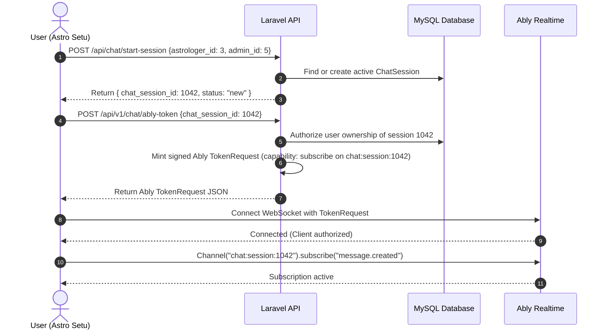
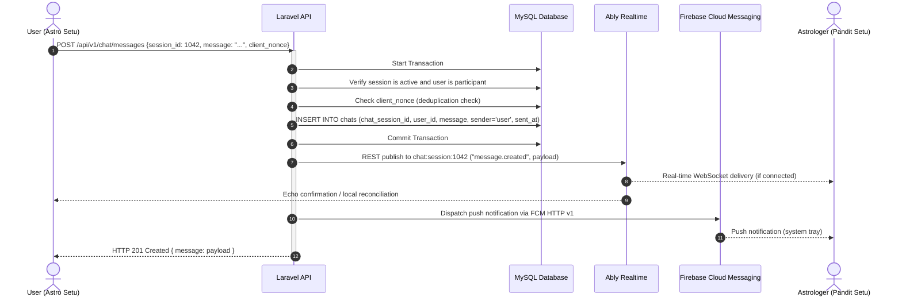
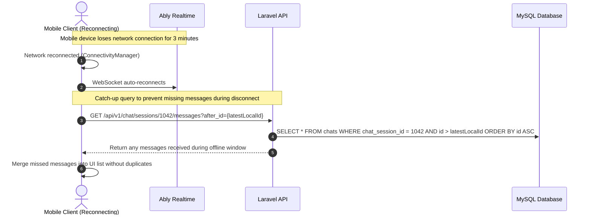

# Proposed Target Architecture: Real-Time Chat via Ably + Laravel MySQL

**Date:** November 2026  
**Status:** Architecture Proposal (Awaiting Approval)

---

## 1. Core Architectural Principles

1. **Laravel + MySQL is the Absolute Source of Truth:**
   - Every chat message is validated, authorized, and stored permanently in MySQL **before** it is broadcast.
   - Message IDs are auto-incrementing integers generated by MySQL.
   - All historical message retrieval is served from Laravel paginated API endpoints.
2. **Ably Realtime is Pure Transport (Ephemeral):**
   - Ably is used exclusively as an ultra-fast, low-latency WebSocket message pipe.
   - Ably message persistence/history is **disabled** (retention is unnecessary since MySQL stores everything).
   - No typing indicators, no presence sets, no read receipts, and no member-enter/leave broadcasts.
3. **Strict Zero-Trust Security via Ably Token Requests:**
   - The Ably API secret key **never leaves the Laravel server**.
   - Clients authenticate to Ably using signed, short-lived **Ably Token Requests** generated by Laravel.
   - Token capabilities are strictly scoped: a user can only subscribe to the specific channel for their active session (`chat:session:{chatSessionId}`) with `subscribe` permission only.
4. **FCM for Background & Offline Delivery:**
   - When a message is stored, Laravel evaluates if the recipient needs an FCM push (e.g. if the recipient is not confirmed active in chat or as a reliable background ping).
   - Ably Push Notifications are **not used**; existing FCM HTTP v1 infrastructure is reused directly.

---

## 2. Division of Responsibilities

```
+---------------------------------------------------------------------------------------------------+
|                                     RESPONSIBILITY MATRIX                                         |
+-------------------+-------------------+-------------------+-------------------+-------------------+
| Component         | Storage           | Auth & Identity   | Real-Time Delivery| Push Notifications|
+-------------------+-------------------+-------------------+-------------------+-------------------+
| Laravel Backend   | MySQL (Source of  | Sanctum Bearer    | REST Publish to   | FCM HTTP v1       |
|                   | Truth: chats,     | Token verification| Ably channel      | dispatch via      |
|                   | chat_sessions)    | & Ably Token Mint |                   | Service Account   |
+-------------------+-------------------+-------------------+-------------------+-------------------+
| Ably Realtime     | None (Ephemeral)  | Validates Signed  | WebSocket pub/sub | None              |
|                   |                   | Token Requests    | to mobile clients |                   |
+-------------------+-------------------+-------------------+-------------------+-------------------+
| Astro Setu        | Local ephemeral   | Sanctum Bearer    | Ably Realtime     | Receives FCM,     |
| (Flutter User)    | UI list in memory | Token for Laravel | Subscriber        | displays local    |
|                   |                   | requests          | (read-only)       | notification      |
+-------------------+-------------------+-------------------+-------------------+-------------------+
| Pandit Setu       | Local ephemeral   | Sanctum Bearer    | Ably Realtime     | Receives FCM,     |
| (Astrologer App)  | UI list in memory | Token for Laravel | Subscriber        | wakes app         |
+-------------------+-------------------+-------------------+-------------------+-------------------+
```

---

## 3. Channel Topology & Security

### 3.1 Channel Naming Pattern
Channels follow a deterministic, private naming convention:
```
chat:session:{chat_session_id}
```
*Example:* `chat:session:1042`

### 3.2 Channel Permissions & Token Scoping
Clients **cannot publish directly to the Ably channel**. This eliminates any risk of spoofed messages, malicious injection, or billable message spamming.

- **Client Token Capabilities:**
  ```json
  {
    "chat:session:1042": ["subscribe"]
  }
  ```
- **Token Request Generation Endpoint:**
  - `POST /api/v1/chat/ably-token` (authenticated via Sanctum)
  - Laravel verifies:
    1. Does `$request->user()->id` match `chat_sessions.user_id` OR does the authenticated astrologer match `chat_sessions.astrologer_id`?
    2. Is `chat_sessions.ended_at` NULL?
  - If valid, Laravel uses `Ably\Auth` to generate a signed `TokenRequest` with a 60-minute TTL.

---

## 4. Message Data Contracts

### 4.1 Client to Laravel: Send Message Request
- **Endpoint:** `POST /api/v1/chat/messages`
- **Headers:** `Authorization: Bearer {sanctum_token}`
- **Payload:**
  ```json
  {
    "chat_session_id": 1042,
    "message": "Namaste Panditji, please check my Kundli.",
    "client_nonce": "f81d4fae-7dec-11d0-a765-00a0c91e6bf6"
  }
  ```
  *(The `client_nonce` is a UUID generated by Flutter to guarantee idempotency and prevent duplicate inserts if the user taps send twice or has a network retry).*

### 4.2 Laravel to Ably & Client Broadcast Payload
When Laravel saves the message to MySQL, it publishes an Ably event named `message.created` on channel `chat:session:1042`:
```json
{
  "id": 8492,
  "chat_session_id": 1042,
  "sender": "user",
  "sender_id": 12,
  "sender_name": "Rohan",
  "message": "Namaste Panditji, please check my Kundli.",
  "sent_at": "2026-11-11T16:45:00Z",
  "client_nonce": "f81d4fae-7dec-11d0-a765-00a0c91e6bf6"
}
```

### 4.3 History Retrieval: Paginated Laravel Endpoint
- **Endpoint:** `GET /api/v1/chat/sessions/{chatSessionId}/messages?before_id=8492&limit=25`
- **Response:**
  ```json
  {
    "messages": [
      {
        "id": 8490,
        "chat_session_id": 1042,
        "sender": "astrologer",
        "sender_name": "Pandit Sharma",
        "message": "Welcome, please share your questions.",
        "sent_at": "2026-11-11T16:44:10Z"
      },
      {
        "id": 8492,
        "chat_session_id": 1042,
        "sender": "user",
        "sender_name": "Rohan",
        "message": "Namaste Panditji, please check my Kundli.",
        "sent_at": "2026-11-11T16:45:00Z"
      }
    ],
    "has_more": false
  }
  ```

---

## 5. End-to-End Architectural Workflows

### 5.1 Chat Session Initialization & Channel Connection


---

### 5.2 Message Send, Persistence & Real-Time Broadcast


---

### 5.3 Offline Catch-Up & Reconnection Flow


---

## 6. Comparison: Existing vs Proposed Architecture

| Architectural Dimension | Existing Firestore Architecture | Proposed Ably + MySQL Architecture |
|---|---|---|
| **Message Persistence** | Firebase Firestore only (MySQL empty) | MySQL is the sole source of truth |
| **Real-Time Transport** | Firestore snapshot listener | Ably WebSocket channel subscription |
| **Client Authentication** | Permissive / unauthenticated Firestore rules | Scoped signed Ably Token Requests |
| **Message Send Path** | Flutter -> Firestore directly | Flutter -> Laravel API -> MySQL -> Ably REST |
| **Push Notification Path**| Flutter -> Laravel (`send-to-astrologer`) -> FCM | Handled centrally inside Laravel message store pipeline |
| **Operational Costs** | Firestore read & write charges on every message | Free Ably tier (up to 6M msgs/mo) + self-hosted MySQL |
| **Client Dependencies** | `cloud_firestore`, `firebase_core`, `firebase_messaging` | `ably_flutter`, `firebase_core`, `firebase_messaging` |
| **History Loading** | Firestore query snapshots (max 20 messages) | Standard paginated SQL API with `before_id` cursor |
| **Offline Reliability** | Dependent on Firestore client cache | Server-guaranteed SQL storage + catch-up API |
